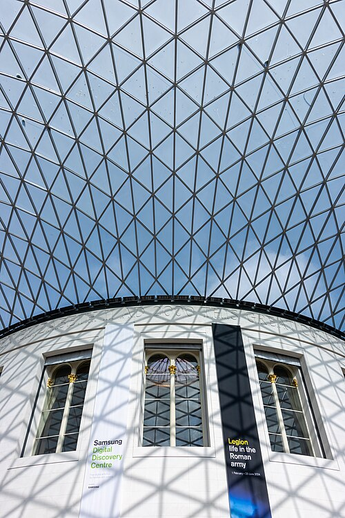
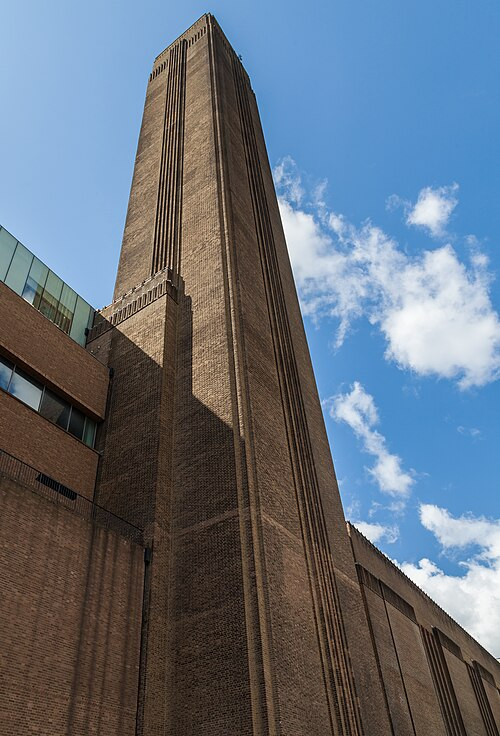
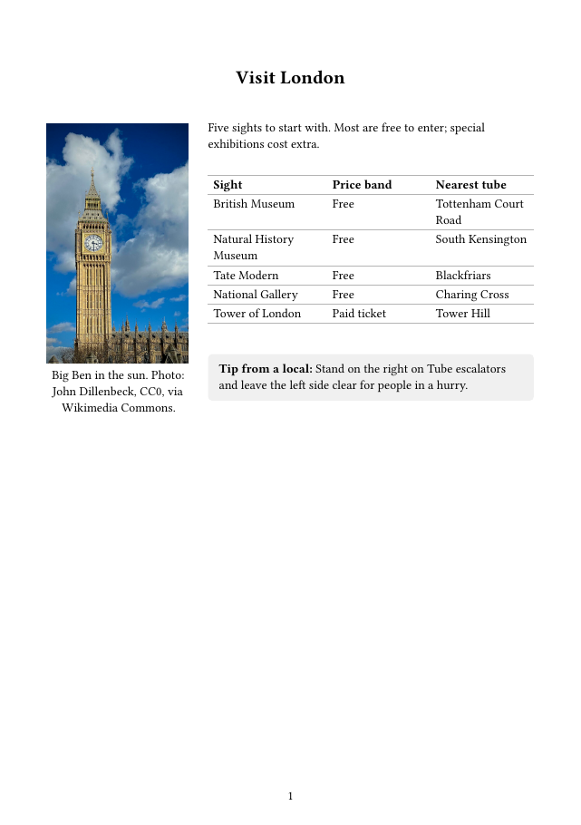

<style>#title-block-header { display: none; }</style>

```{python}
#| include: false
import csv

with open("data/attractions.csv", newline="", encoding="utf-8") as f:
    rows = list(csv.DictReader(f))

top = max(rows, key=lambda r: int(r["visits_2025"]))
top_name = top["attraction"].split(" (")[0].removeprefix("The ")
total = sum(int(r["visits_2025"]) for r in rows)
n_free = sum(r["admission"].startswith("Free") for r in rows)
```

```{python}
#| echo: false
#| output: asis
print(f"""
<section class="hero" style="background-image: url('images/big-ben.jpg');">
  <h1>Visit London</h1>
  <p class="tagline">A city where <strong>centuries of history</strong> sit side by side with modern life.</p>
  <a class="btn btn-gold" href="london.html">Read the guide</a>
  <a class="btn btn-ghost" href="london-dashboard.html">Explore the data</a>
  <a class="btn btn-ghost" href="materials.html">Get the materials</a>
  <p class="credit">Big Ben in the sun. Photo: John Dillenbeck, CC0, via Wikimedia Commons.</p>
</section>

<div class="stats">
  <div class="stat"><div class="num">{total / 1e6:.1f}M</div><div class="lbl">visits to London's top 10 in 2025</div></div>
  <div class="stat"><div class="num">{top_name}</div><div class="lbl">most visited attraction</div></div>
  <div class="stat"><div class="num">{n_free} of {len(rows)}</div><div class="lbl">free to enter</div></div>
</div>
""")
```

## Everything in one place

::: {.cards}
::: {.lg-card}
::: {.thumb}

:::
::: {.body}
### The guide
Five sights to start with, how to get around, and what to pack. Also as Word, PDF, PowerPoint, EPUB and slides.

::: {.actions}
[Read online](london.qmd)
[Slides](london-slides.html){.alt}
:::
:::
:::

::: {.lg-card}
::: {.thumb}

:::
::: {.body}
### The dashboard
Visitor numbers for London's most-visited attractions, and how they have recovered since 2019.

::: {.actions}
[Open dashboard](london-dashboard.qmd)
:::
:::
:::

::: {.lg-card}
::: {.thumb}

:::
::: {.body}
### Partner materials
A partner email brief, a printable flyer and a social post, ready to send or share.

::: {.actions}
[See all materials](materials.qmd)
:::
:::
:::
:::

Visitor numbers are from the Association of Leading Visitor Attractions (ALVA).
