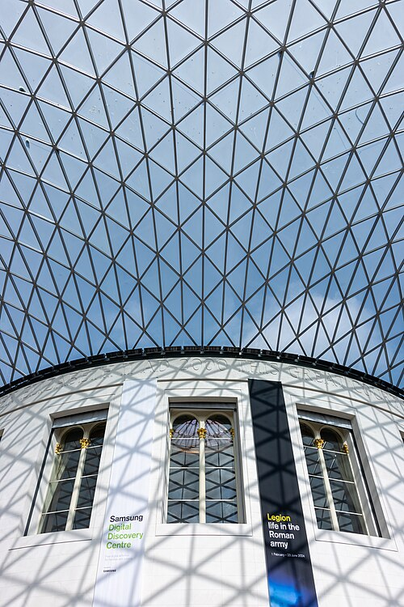
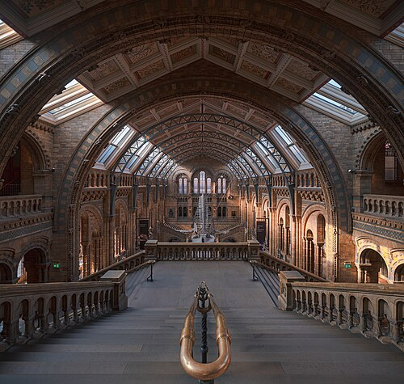
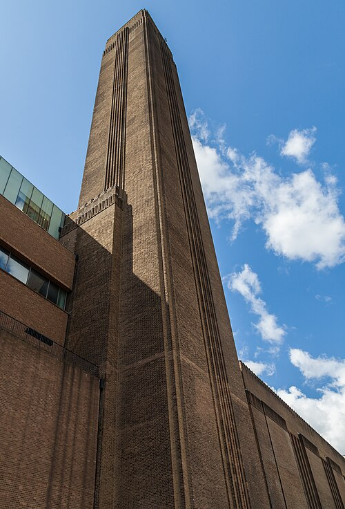
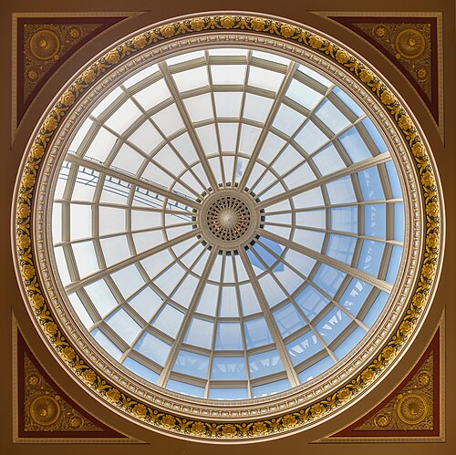
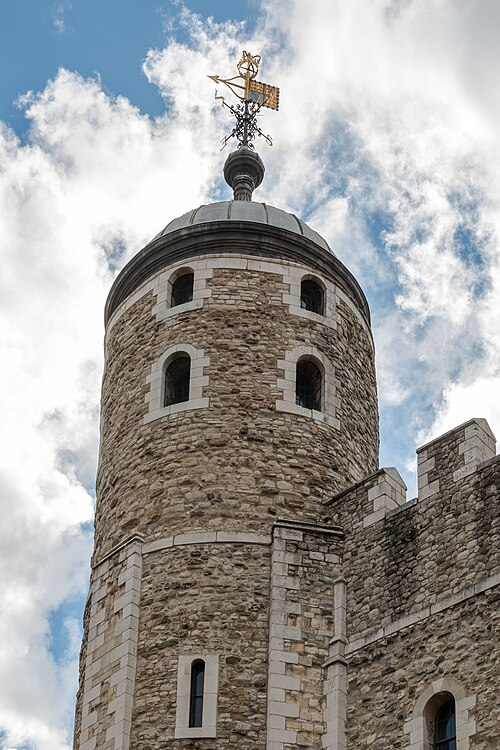
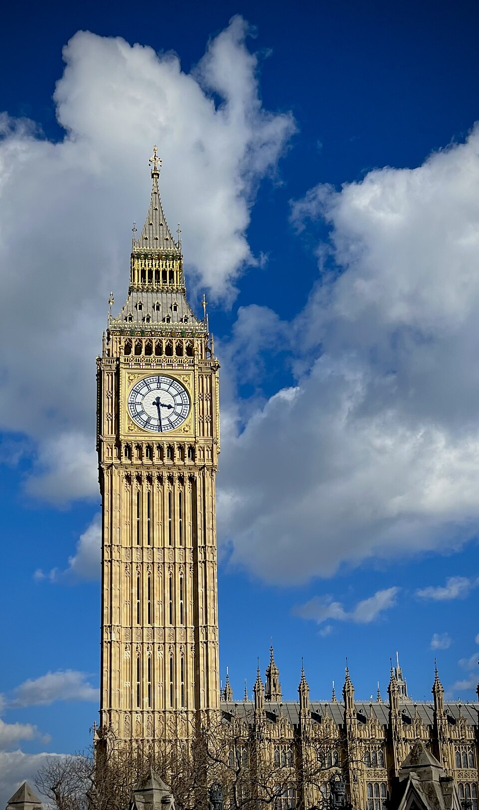

Welcome to London, a city where **centuries of history** sit side by side with modern life. Whether you're wandering along the Thames, exploring world-class museums, or simply enjoying a pint in a cosy pub, you'll find that there is *something for every traveller* around each corner.

## Five sights to start with

1. British Museum
2. Natural History Museum
3. Tate Modern
4. National Gallery
5. Tower of London



*British Museum, Great Court. Photo: Mike Peel ([www.mikepeel.net](https://www.mikepeel.net)), [CC BY-SA 4.0](https://creativecommons.org/licenses/by-sa/4.0), via [Wikimedia Commons](https://commons.wikimedia.org/wiki/File:At_the_British_Museum_2024_006.jpg).*



*Natural History Museum, Central Hall. Photo: Julian Herzog, [CC BY 4.0](https://creativecommons.org/licenses/by/4.0), via [Wikimedia Commons](https://commons.wikimedia.org/wiki/File:Natural_History_Museum_London_Central_Hall_2020_01.jpg).*



*Tate Modern, the former Bankside Power Station. Photo: Diego Delso, [CC BY-SA 4.0](https://creativecommons.org/licenses/by-sa/4.0), via [Wikimedia Commons](https://commons.wikimedia.org/wiki/File:Tate_Modern,_Londres,_Inglaterra,_2014-08-11,_DD_124.JPG).*



*National Gallery, entrance hall dome. Photo: Diego Delso, [CC BY-SA 4.0](https://creativecommons.org/licenses/by-sa/4.0), via [Wikimedia Commons](https://commons.wikimedia.org/wiki/File:B%C3%B3veda_de_la_sala_de_entrada,_Galer%C3%ADa_Nacional,_Londres,_Inglaterra,_2014-08-11,_DD_170-172_HDR.JPG).*



*Tower of London, the White Tower. Photo: Dietmar Rabich, [CC BY-SA 4.0](https://creativecommons.org/licenses/by-sa/4.0), via [Wikimedia Commons](https://commons.wikimedia.org/wiki/File:London,_Tower_of_London,_White_Tower_--_2016_--_4679.jpg).*

## Sights at a glance

| Photo | Sight | Area | Price band | Nearest tube | More |
|:--:|---|---|---|---|---|
| {height=60px} | British Museum | Bloomsbury | Free (special exhibitions extra) | Tottenham Court Road | [Read more](https://www.britishmuseum.org) |
| {height=60px} | Natural History Museum | South Kensington | Free (special exhibitions extra) | South Kensington | [Read more](https://www.nhm.ac.uk) |
| {height=60px} | Tate Modern | Bankside | Free (special exhibitions extra) | Blackfriars | [Read more](https://www.tate.org.uk/visit/tate-modern) |
| {height=60px} | National Gallery | Trafalgar Square | Free (special exhibitions extra) | Charing Cross | [Read more](https://www.nationalgallery.org.uk) |
| {height=60px} | Tower of London | Tower Hill | Paid ticket | Tower Hill | [Read more](https://www.hrp.org.uk/tower-of-london/) |

*Photo credits: British Museum, Mike Peel, [CC BY-SA 4.0](https://creativecommons.org/licenses/by-sa/4.0); Natural History Museum, Julian Herzog, [CC BY 4.0](https://creativecommons.org/licenses/by/4.0); Tate Modern and National Gallery, Diego Delso, [CC BY-SA 4.0](https://creativecommons.org/licenses/by-sa/4.0); Tower of London, Dietmar Rabich, [CC BY-SA 4.0](https://creativecommons.org/licenses/by-sa/4.0). All via Wikimedia Commons; details in `images/ATTRIBUTION.md`.*

## Visitor numbers

```{python}
#| echo: true
import csv

with open("data/attractions.csv", newline="", encoding="utf-8") as f:
    rows = list(csv.DictReader(f))

top = max(rows, key=lambda r: int(r["visits_2025"]))
top_name = top["attraction"]
top_visits = int(top["visits_2025"])
total_visits = sum(int(r["visits_2025"]) for r in rows)
```

The most visited attraction in 2025 was the `{python} top_name`, with `{python} f"{top_visits:,}"` visits, out of `{python} f"{total_visits:,}"` visits in total across the ten attractions listed.

```{python}
#| echo: false
#| label: fig-top10
#| fig-cap: "Visits in 2025 to London's ten most-visited ALVA attractions. Source: ALVA."
#| fig-alt: "Horizontal bar chart of 2025 visits for ten London attractions, sorted from most to least visited. The Natural History Museum is highest at about 7.1 million, followed by the British Museum at 6.4 million and Tate Modern at 4.5 million. The Science Museum and Royal Museums Greenwich are lowest at about 2.6 and 2.4 million."
import matplotlib.pyplot as plt

ranked = sorted(rows, key=lambda r: int(r["visits_2025"]))
names = [r["attraction"] for r in ranked]
values = [int(r["visits_2025"]) / 1e6 for r in ranked]

fig, ax = plt.subplots(figsize=(8, 4.5))
bars = ax.barh(names, values, height=0.6, color="#2f6db5")
ax.bar_label(bars, labels=[f"{v:.1f}M" for v in values], padding=4, fontsize=9)
ax.set_xlabel("Visits in 2025 (millions)")
ax.set_xlim(0, max(values) * 1.12)
ax.xaxis.grid(True, color="#e3e3e3", linewidth=0.8)
ax.set_axisbelow(True)
for side in ("top", "right", "left"):
    ax.spines[side].set_visible(False)
ax.tick_params(axis="y", length=0)
fig.tight_layout()
plt.show()
```

## Getting around

- 🚇 Tube
- 🚌 Bus
- 🚲 Santander Cycles

## Plan your visit

Use the [TfL Journey Planner](https://tfl.gov.uk/plan-a-journey/) to map out each day's route by Tube, bus or bike.



*Big Ben in the sun (Elizabeth Tower). Photo: John Dillenbeck, CC0, via [Wikimedia Commons](https://commons.wikimedia.org/wiki/File:Big_Ben_in_the_sun.jpg).*

> **Tip from a local:** Stand on the right on Tube escalators and leave the left side clear for people in a hurry.

## Before you go

```text
[ ] Check opening times and book any timed tickets
[ ] Bring a contactless card or Oyster for the Tube and buses
[ ] Pack a light waterproof jacket
```
