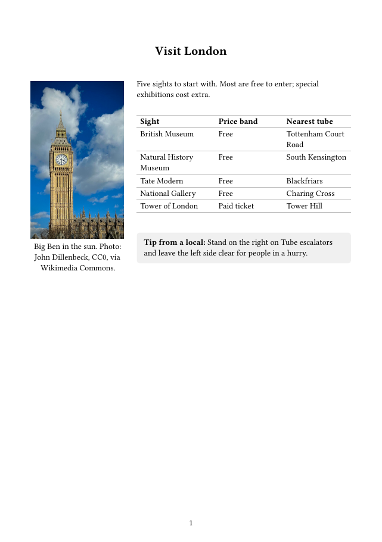
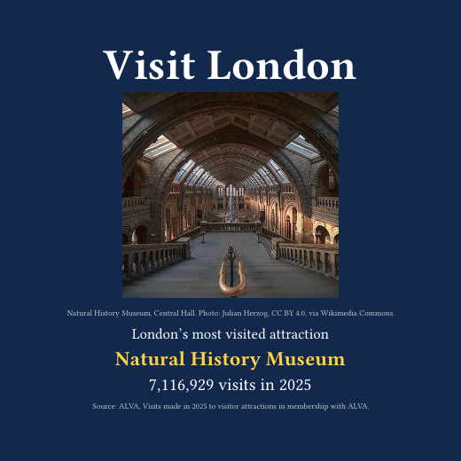

::: {.cards}
::: {.lg-card}
::: {.thumb}
<i class="bi bi-envelope-paper"></i>
:::
::: {.body}
### Partner email brief
Why London, five sights with official links, getting around, and sources. Attach it to an email.

::: {.actions}
[Download .docx](london-email.docx)
:::
:::
:::

::: {.lg-card}
::: {.thumb}

:::
::: {.body}
### Flyer {#flyer-card}
A5 flyer with the five sights, price bands and nearest tube stations.

::: {.actions}
[Download PDF](london-flyer.pdf)
[Preview](#flyer){.alt}
:::
:::
:::

::: {.lg-card}
::: {.thumb}

:::
::: {.body}
### Social post {#social-card}
Square post highlighting London's most visited attraction in 2025.

::: {.actions}
[Download PDF](london-social.pdf)
[Preview](#social-post){.alt}
:::
:::
:::
:::

## Flyer {#flyer}

<iframe class="viewer" src="london-flyer.pdf" title="Visit London flyer"></iframe>

## Social post {#social-post}

<iframe class="viewer" src="london-social.pdf" title="Visit London social media post"></iframe>
